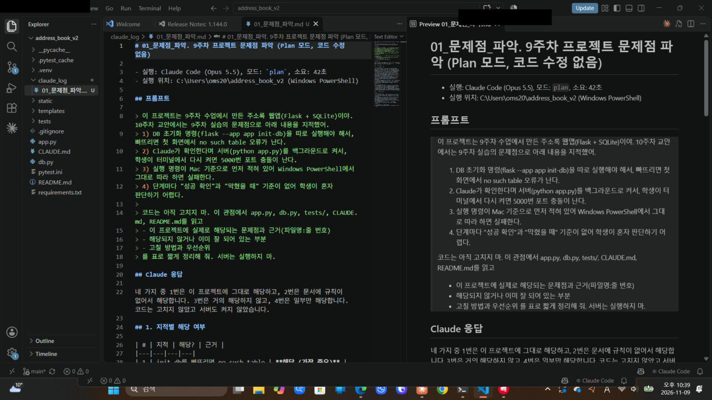
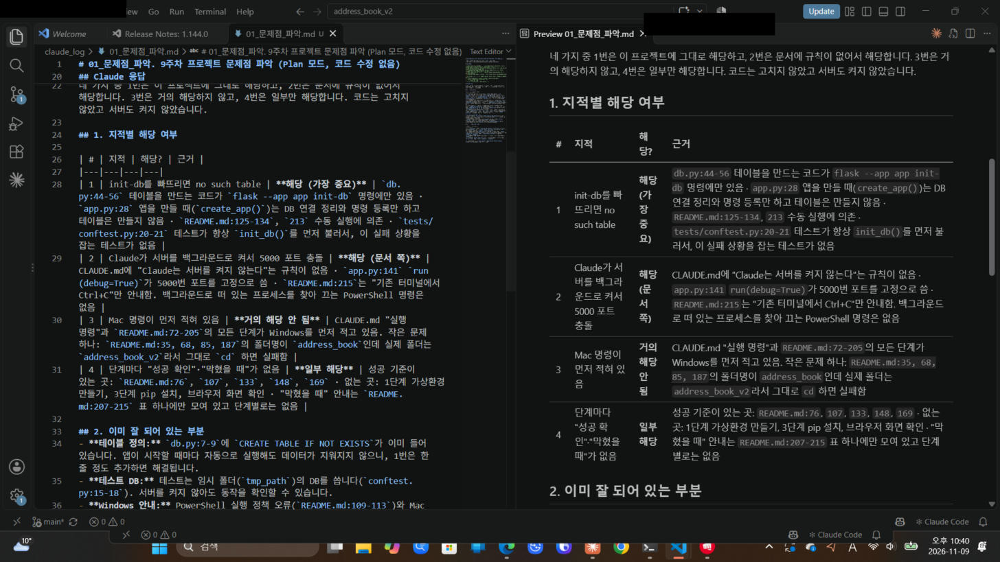
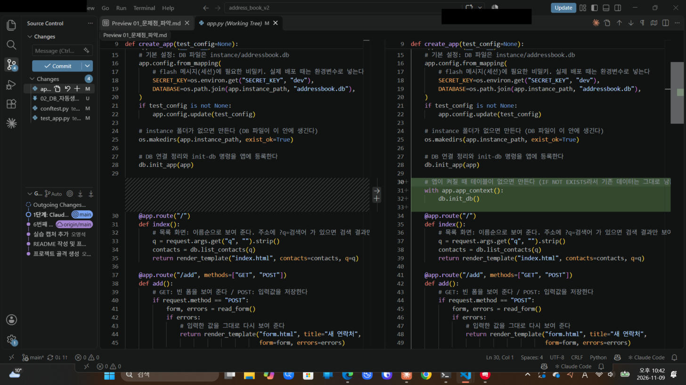
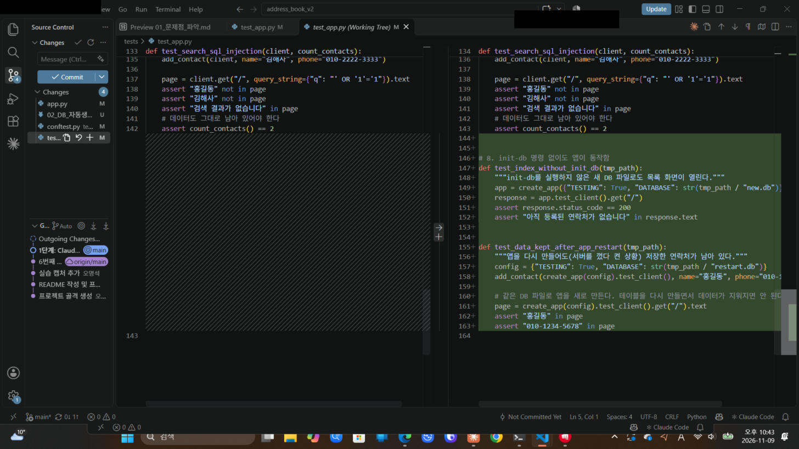
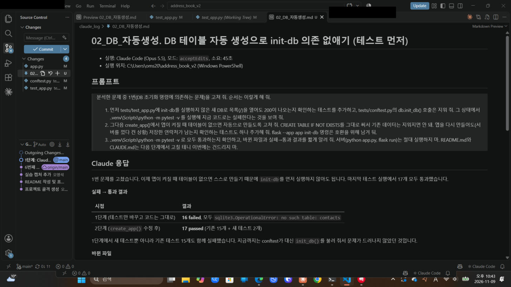
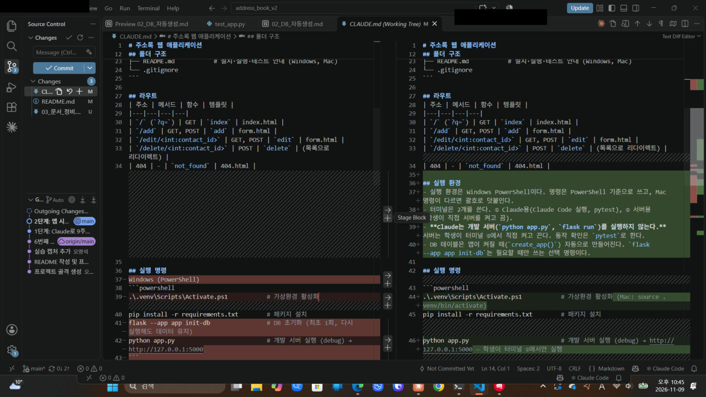
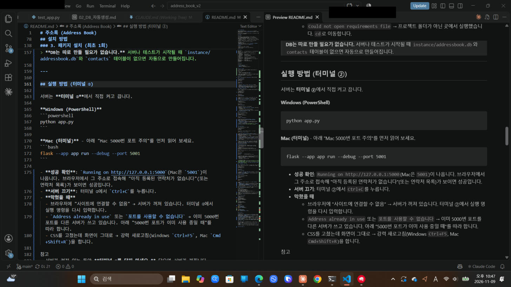
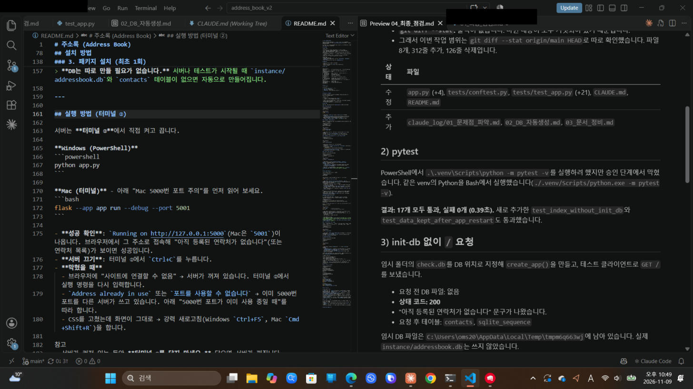
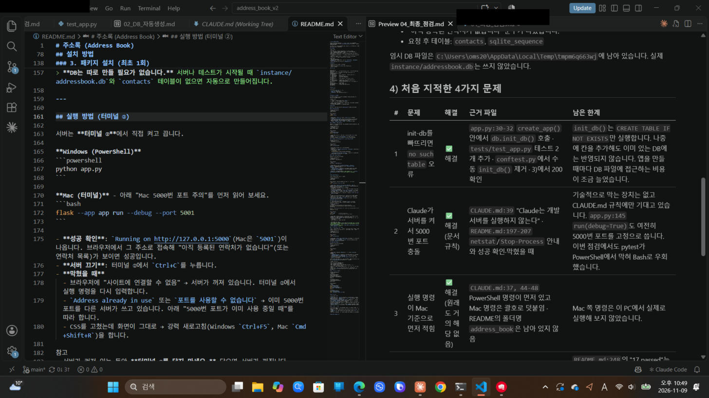

# 주소록 (Address Book)

Python **Flask**와 **SQLite**로 만든 주소록 관리 웹 애플리케이션입니다.
별도의 DB 서버 없이 파일 하나(`instance/addressbook.db`)에 데이터를 저장하므로 설치가 간단합니다.

파일 수는 적게 유지하면서도 실무에서 쓰는 구조(앱 팩토리, DB 모듈 분리, 템플릿 상속, 자동 테스트)를 따랐습니다.

## 주요 기능

| 기능 | 설명 |
|---|---|
| 목록 보기 | 모든 연락처를 이름 가나다순으로 표에 보여 줍니다. |
| 등록 | 이름(필수), 전화번호(필수), 이메일, 주소, 메모를 입력합니다. |
| 수정 | 기존 값이 채워진 폼에서 고칩니다. |
| 삭제 | 확인 창("정말 삭제하시겠습니까?")을 거쳐 삭제합니다. POST 요청으로만 처리합니다. |
| 검색 | 이름 또는 전화번호의 일부로 찾습니다. 전화번호는 하이픈이 있어도 없어도 검색됩니다. |
| 입력 검증 | 서버에서 검사하고, 틀린 칸과 이유를 한글로 알려 줍니다. |
| 반응형 화면 | 휴대폰에서는 표가 카드 형태로 바뀝니다. |

**입력 규칙**
- 이름: 필수, 30자 이하
- 전화번호: 필수, 숫자와 하이픈만 사용 (예: `010-1234-5678`, `01012345678`, `02-123-4567`)
- 이메일: 입력했다면 이메일 형식 (예: `hong@example.com`)

## 기술 스택

- Python 3.10 이상 (3.13에서 개발·테스트)
- Flask 3.1
- SQLite (파이썬 기본 내장 `sqlite3` 모듈, 추가 설치 없음)
- pytest 9 (테스트)

## 폴더 구조

```
address_book_v2/
├── app.py              # 앱 생성(create_app, 시작할 때 DB 테이블 자동 생성), 화면별 라우트, 입력 검증
├── db.py               # DB 연결, 테이블 정의, init-db 명령(선택), 등록·조회·수정·삭제·검색 함수
├── templates/
│   ├── base.html       # 모든 화면의 공통 틀 (상단 바, 안내 메시지)
│   ├── index.html      # 목록 + 검색
│   ├── form.html       # 등록·수정 공용 입력 폼
│   └── 404.html        # 없는 페이지·연락처 안내
├── static/
│   └── style.css       # 화면 디자인 (외부 CSS 라이브러리 없음)
├── tests/
│   ├── conftest.py     # 테스트 공통 준비물 (테스트 전용 임시 DB)
│   └── test_app.py     # 기능·검증·보안 테스트
├── instance/           # 실행하면 자동 생성. DB 파일이 저장됨 (git에 올리지 않음)
├── pytest.ini          # pytest 설정
├── requirements.txt    # 설치할 패키지 목록
├── CLAUDE.md           # Claude Code용 프로젝트 안내
└── README.md
```

## 화면과 주소

| 주소 | 화면 |
|---|---|
| `/` | 목록 (`/?q=검색어` 로 검색) |
| `/add` | 새 연락처 등록 |
| `/edit/<id>` | 연락처 수정 |
| `/delete/<id>` | 삭제 (POST 전용, 화면 없음) |

---

## 터미널 2개 사용하기

VS Code에서 터미널을 2개 열어 역할을 나눕니다. (터미널 패널 오른쪽 위 `+` 버튼으로 새 터미널을 엽니다.)

| 터미널 | 용도 |
|---|---|
| ① Claude용 | Claude Code 실행, 설치, `pytest -v` |
| ② 서버용 | 개발 서버 켜기·끄기 (학생이 직접) |

- 서버는 켜 두는 동안 터미널을 계속 차지하므로 ②에서만 실행합니다. Claude에게 서버 실행을 맡기지 않습니다.
- 두 터미널 모두 가상환경을 켜야 합니다(아래 2단계).

## 설치 방법

아래 명령은 모두 **프로젝트 폴더(`address_book_v2`) 안에서** 실행합니다.

### 0. Python 설치 확인

**Windows (PowerShell)**
```powershell
python --version
```

**Mac (터미널)**
```bash
python3 --version
```

- **성공 확인**: `Python 3.10` 이상(예: `Python 3.13.1`)이 나옵니다.
- **막혔을 때**
  - `python을 찾을 수 없습니다` 또는 Microsoft Store가 열림 → https://www.python.org/downloads/ 에서 설치합니다. 첫 화면의 **"Add python.exe to PATH"를 꼭 체크**하고, 설치 후 터미널을 새로 엽니다.
  - Mac에서 `command not found` → `python` 대신 `python3`을 씁니다.

### 1. 가상환경 만들기 (최초 1회)

가상환경은 이 프로젝트 전용 패키지 설치 공간입니다. 다른 프로젝트와 패키지 버전이 섞이지 않게 해 줍니다.

**Windows (PowerShell)**
```powershell
cd 경로\address_book_v2
python -m venv .venv
```

**Mac (터미널)**
```bash
cd 경로/address_book_v2
python3 -m venv .venv
```

- **성공 확인**: 아무 메시지 없이 끝나고, 프로젝트 폴더에 `.venv` 폴더가 생깁니다.
- **막혔을 때**: `경로를 찾을 수 없습니다` → `cd` 뒤의 경로가 맞는지 확인합니다. 탐색기에서 폴더를 터미널로 끌어 놓으면 경로가 입력됩니다.

### 2. 가상환경 켜기 (터미널을 새로 열 때마다, 터미널 ①·② 모두)

**Windows (PowerShell)**
```powershell
.\.venv\Scripts\Activate.ps1
```

**Mac (터미널)**
```bash
source .venv/bin/activate
```

- **성공 확인**: 프롬프트 앞에 `(.venv)`가 붙습니다.
- **막혔을 때**
  - Windows에서 `이 시스템에서 스크립트를 실행할 수 없으므로…` → 아래 명령을 한 번 실행한 뒤 다시 켭니다.
    ```powershell
    Set-ExecutionPolicy -Scope CurrentUser RemoteSigned
    ```
  - `.venv\Scripts\Activate.ps1을 찾을 수 없음` → 1단계를 하지 않았거나 다른 폴더에 있습니다. 프로젝트 폴더로 `cd` 합니다.

### 3. 패키지 설치 (최초 1회)

가상환경이 켜진 상태에서 실행합니다.

**Windows (PowerShell)**
```powershell
pip install -r requirements.txt
```

**Mac (터미널)**
```bash
pip install -r requirements.txt
```

- **성공 확인**: 마지막에 `Successfully installed ... Flask-3.1... pytest-9...`가 나옵니다. (이미 설치돼 있으면 `Requirement already satisfied`만 나와도 정상입니다.)
- **막혔을 때**
  - `pip을 찾을 수 없음` → 가상환경이 꺼져 있습니다. 2단계를 다시 합니다.
  - `Could not open requirements file` → 프로젝트 폴더가 아닌 곳에서 실행했습니다. `cd`로 이동합니다.

> **DB는 따로 만들 필요가 없습니다.** 서버나 테스트가 시작될 때 `instance/addressbook.db`와 `contacts` 테이블이 없으면 자동으로 만들어집니다.

---

## 실행 방법 (터미널 ②)

서버는 **터미널 ②**에서 직접 켜고 끕니다.

**Windows (PowerShell)**
```powershell
python app.py
```

**Mac (터미널)** - 아래 "Mac 5000번 포트 주의"를 먼저 읽어 보세요.
```bash
flask --app app run --debug --port 5001
```

- **성공 확인**: `Running on http://127.0.0.1:5000`(Mac은 `5001`)이 나옵니다. 브라우저에서 그 주소로 접속해 "아직 등록된 연락처가 없습니다"(또는 연락처 목록)가 보이면 성공입니다.
- **서버 끄기**: 터미널 ②에서 `Ctrl+C`를 누릅니다.
- **막혔을 때**
  - 브라우저에 "사이트에 연결할 수 없음" → 서버가 꺼져 있습니다. 터미널 ②에서 실행 명령을 다시 입력합니다.
  - `Address already in use` 또는 `포트를 사용할 수 없습니다` → 이미 5000번 포트를 다른 서버가 쓰고 있습니다. 아래 "5000번 포트가 이미 사용 중일 때"를 따라 합니다.
  - CSS를 고쳤는데 화면이 그대로 → 강력 새로고침(Windows `Ctrl+F5`, Mac `Cmd+Shift+R`)을 합니다.

참고
- 서버가 켜져 있는 동안 **터미널 ②를 닫지 마세요.** 닫으면 서버가 꺼집니다.
- debug 모드라서 코드를 고치고 저장하면 서버가 자동으로 다시 시작됩니다. 브라우저만 새로고침하면 됩니다.
- Windows에서도 `flask --app app run --debug` 명령으로 실행할 수 있습니다. `python app.py`와 결과가 같습니다.

### 5000번 포트가 이미 사용 중일 때

먼저 다른 터미널(이전에 서버를 켠 터미널)에서 `Ctrl+C`로 끌 수 있는지 확인합니다. 터미널을 이미 닫아서 끌 수 없으면 아래처럼 찾아서 끕니다.

**Windows (PowerShell)**
```powershell
# 1) 5000번 포트를 쓰는 프로그램 찾기 (Id가 프로세스 번호)
Get-Process -Id (Get-NetTCPConnection -LocalPort 5000 -State Listen).OwningProcess

# 2) 찾은 프로그램 끄기 (python이 맞는지 확인한 뒤, 1234 자리에 위에서 본 Id를 넣는다)
Stop-Process -Id 1234
```

**Mac (터미널)**
```bash
lsof -i :5001          # PID 칸이 프로세스 번호
kill 1234              # 1234 자리에 위에서 본 PID를 넣는다
```

- **성공 확인**: 1)을 다시 실행했을 때 아무것도 나오지 않으면(또는 "찾을 수 없습니다" 오류) 포트가 비었습니다. 이제 서버를 다시 켭니다.
- **막혔을 때**: 1)에서 `python`이 아닌 다른 프로그램이 나오면 끄지 말고, 그 대신 다른 포트로 실행합니다.
  ```powershell
  flask --app app run --debug --port 5001
  ```

> **Mac 5000번 포트 주의**
> macOS 12(Monterey) 이후에는 **AirPlay 수신 모드**가 5000번 포트를 사용합니다.
> 그래서 5000번으로 실행하면 "Address already in use" 오류가 나거나 브라우저에 403 오류가 뜰 수 있습니다.
> 위처럼 `--port 5001`로 실행하거나, `시스템 설정 → 일반 → AirDrop 및 Handoff → AirPlay 수신 모드`를 끄세요.

### (선택) DB 테이블만 미리 만들기

테이블은 서버·테스트가 시작될 때 자동으로 만들어지므로 **보통은 실행하지 않아도 됩니다.** 서버를 켜지 않고 DB 파일만 먼저 만들어 확인하고 싶을 때 씁니다.

**Windows (PowerShell)**
```powershell
flask --app app init-db
```

**Mac (터미널)**
```bash
flask --app app init-db
```

- **성공 확인**: `데이터베이스를 초기화했습니다.`가 나옵니다. 여러 번 실행해도 기존 데이터는 지워지지 않습니다.
- **막혔을 때**: `No such command 'init-db'` → 프로젝트 폴더가 아닌 곳에서 실행했거나 `--app app`을 빠뜨렸습니다.

## 테스트 방법 (터미널 ①)

가상환경이 켜진 상태에서 실행합니다.

**Windows (PowerShell)**
```powershell
pytest -v
```

**Mac (터미널)**
```bash
pytest -v
```

- **성공 확인**: 테스트마다 `PASSED`가 붙고, 마지막 줄에 `17 passed`가 나옵니다.
- **막혔을 때**
  - `pytest을 찾을 수 없음` → 가상환경이 꺼져 있거나 3단계를 하지 않았습니다.
  - `ModuleNotFoundError: No module named 'app'` → 프로젝트 폴더가 아닌 곳에서 실행했습니다. `cd`로 이동합니다.
  - `FAILED`가 있음 → 맨 아래 `short test summary info`에서 실패한 테스트 이름과 이유를 확인합니다.

테스트는 매번 **임시 DB**를 새로 만들어 사용합니다. 서버가 켜져 있어도 상관없고, 실제 `instance/addressbook.db`의 데이터는 바뀌지 않습니다.

| 테스트 | 확인 내용 |
|---|---|
| 목록 | 목록 화면이 정상(200) 응답 |
| 등록 | 등록하면 목록에 나타남 |
| 수정 | 수정하면 화면과 DB 값이 바뀜 |
| 삭제 | 삭제하면 목록에서 사라짐, GET 요청으로는 삭제되지 않음 |
| 검색 | 이름 검색, 결과 없음 안내 |
| 입력 검증 | 이름이 비었거나 전화번호 형식이 틀리면 저장되지 않음 (등록 6가지 경우·수정) |
| 보안 | 검색어 `' OR '1'='1`(SQL 인젝션 시도)로 모든 데이터가 나오지 않음 |
| DB 자동 생성 | init-db 없이 새 DB로 목록이 열림, 앱을 다시 켜도 저장한 데이터가 남음 |

## 처음부터 순서대로 (요약)

**Windows (PowerShell)**
```powershell
# 터미널 ①
cd 경로\address_book_v2
python -m venv .venv
.\.venv\Scripts\Activate.ps1
pip install -r requirements.txt
pytest -v

# 터미널 ②
cd 경로\address_book_v2
.\.venv\Scripts\Activate.ps1
python app.py
```

**Mac (터미널)**
```bash
# 터미널 ①
cd 경로/address_book_v2
python3 -m venv .venv
source .venv/bin/activate
pip install -r requirements.txt
pytest -v

# 터미널 ②
cd 경로/address_book_v2
source .venv/bin/activate
flask --app app run --debug --port 5001
```

## 자주 겪는 문제

| 증상 | 원인과 해결 |
|---|---|
| `python`(또는 `pip`, `flask`)을 찾을 수 없음 | Python이 설치되지 않았거나 PATH에 없습니다. Mac은 `python3`을 쓰세요. `flask`, `pytest`가 없다고 나오면 가상환경이 켜져 있는지 확인하세요. |
| `ModuleNotFoundError: No module named 'flask'` | 가상환경을 켜지 않았거나 패키지를 설치하지 않았습니다. 2·3단계를 다시 하세요. |
| `no such table: contacts` | 테이블은 서버가 켜질 때 자동으로 만들어집니다. 터미널 ②에서 `Ctrl+C`로 서버를 끄고 다시 켜세요. |
| 브라우저에 "사이트에 연결할 수 없음" | 서버가 꺼져 있습니다. 터미널 ②에서 실행 명령을 다시 입력하세요. |
| `Address already in use` | 이미 같은 포트에서 서버가 실행 중입니다. "5000번 포트가 이미 사용 중일 때"를 따라 끄거나, `--port 5001`처럼 다른 포트를 쓰세요. |

## 참고: 배포할 때 주의

이 프로젝트는 학습용 개발 서버 설정입니다. 다른 사람이 접속하는 서버에 올릴 때는 다음을 지켜야 합니다.
- debug 모드를 끕니다. debug 모드에서는 오류 화면을 통해 서버 코드를 실행할 수 있습니다.
- `SECRET_KEY` 환경변수에 추측하기 어려운 값을 넣습니다. 기본값 `"dev"`를 쓰지 않습니다.
- CSRF 보호를 추가합니다. 지금은 다른 사이트에서 삭제 요청을 보낼 수 있습니다.


## 실습 기록 (6번째 과제)

9주차 주소록 프로젝트(5번째 과제, [address_book](https://github.com/20230552-oms/address_book))를 복사해서, 10주차 교안에서 짚은 9주차 실습의 문제점이 이 프로젝트에도 있는지 Claude로 먼저 확인했습니다. 그다음 단계별 프롬프트로 고치고, 단계마다 VS Code 화면을 캡처했습니다.

- Claude Code는 PowerShell에서 `claude -p`(대화 없이 한 번 실행)로 단계마다 실행했습니다. 단계마다 프롬프트와 Claude의 응답 전체를 [`claude_log/`](claude_log) 폴더에 저장했습니다.
- 코드가 바뀐 단계는 VS Code의 소스 제어(Source Control) diff 화면으로 확인했습니다.
- 단계마다 커밋해서, 커밋 기록만 봐도 1~4단계 진행 과정이 보이게 했습니다.

| 단계 | 모드 | 내용 | 결과 |
|---|---|---|---|
| 1 | plan (수정 없음) | 문제점 파악 | 4가지 지적 중 1번(init-db 의존)과 2번(서버 실행 규칙 없음)이 그대로 해당 |
| 2 | acceptEdits | DB 테이블 자동 생성, 테스트 먼저 | 16 failed → 17 passed |
| 3 | acceptEdits | CLAUDE.md·README.md 정비 | 서버는 학생이 직접 실행, PowerShell 기준, 단계별 성공 확인·막혔을 때 |
| 4 | 점검 | pytest와 init-db 없이 첫 화면 확인 | 17 passed, 상태 코드 200 |

### 1단계. 문제점 파악 (Plan 모드, 코드 수정 없음)
10주차 교안에서 지적한 4가지 문제를 그대로 프롬프트에 넣고, 코드는 고치지 말고 파일명과 줄 번호를 근거로 해당 여부만 정리하게 했습니다.



Claude는 1번(init-db를 빠뜨리면 `no such table`)이 가장 중요하다고 판단했습니다. 테이블을 만드는 코드가 `flask --app app init-db` 명령에만 있고, `conftest.py`가 테스트마다 `init_db()`를 먼저 불러 줘서 이 문제를 테스트가 잡지 못하고 있었습니다. 3번(Mac 명령이 먼저)은 이미 Windows가 먼저 적혀 있어서 거의 해당하지 않는다고 했습니다. 지적을 그대로 받아들이지 않고 해당 여부를 구분해 준 점이 좋았습니다.



### 2단계. 앱 시작 시 DB 테이블 자동 생성 (테스트 먼저)
테스트를 먼저 바꿔서 지금 코드가 실패하는 것을 보여 주고, 그다음 코드를 고치게 했습니다. `create_app()`에 3줄을 추가했고, 기존 `CREATE TABLE IF NOT EXISTS`를 그대로 써서 저장된 데이터는 지워지지 않습니다.



추가한 테스트는 2개입니다. 하나는 init-db 없이 새 DB로 첫 화면을 여는 테스트이고, 다른 하나는 앱을 다시 만들어도(서버를 껐다 켠 상황) 데이터가 남는지 확인하는 테스트입니다.



`conftest.py`의 `init_db()`를 지우자 새 테스트뿐 아니라 기존 테스트 15개도 모두 `no such table`로 실패했습니다(16 failed). 9주차에는 테스트 준비 코드가 문제를 가리고 있었다는 뜻입니다. 고친 뒤에는 17 passed가 나왔습니다.



### 3단계. CLAUDE.md·README.md 정비
CLAUDE.md에 실행 환경 절을 새로 넣었습니다. 서버는 Claude가 실행하지 않고 학생이 터미널 ②에서 직접 켠다는 규칙과, 동작 확인은 pytest로 한다는 규칙을 적었습니다.



README는 필수 단계에서 DB 초기화를 빼고, 단계마다 성공 확인과 막혔을 때를 넣었습니다. 5000번 포트가 이미 사용 중일 때 PowerShell에서 찾아 끄는 방법도 추가했습니다.



### 4단계. 최종 점검
파일은 고치지 말고 확인만 하게 했습니다. pytest는 17개 모두 통과했습니다. DB 파일이 없는 상태에서 init-db 없이 `/`를 요청하자 200이 나왔고, 요청 뒤에는 `contacts` 테이블이 만들어져 있었습니다.



처음 지적한 4가지 문제별로 해결 여부와 남은 한계를 표로 받았습니다.



### 5. 직접 서버 실행 (학생 역할)
`instance/` 폴더가 없는 상태에서 직접 `python app.py`로 서버를 켜고 브라우저로 접속했습니다. init-db를 실행하지 않았는데도 첫 화면이 정상으로 나왔고, 서버 로그에도 `"GET / HTTP/1.1" 200`이 찍혔습니다.


### 남은 한계
- 서버를 실행하지 않는다는 규칙은 CLAUDE.md와 프롬프트로만 막고 있습니다. Claude가 규칙을 놓치면 여전히 서버를 켤 수 있으므로, 대화형으로 쓸 때는 manual 모드의 승인 단계에서 한 번 더 확인해야 합니다.
- `CREATE TABLE IF NOT EXISTS`는 이미 있는 테이블을 바꾸지 않습니다. 나중에 칸을 추가하면 기존 DB에는 반영되지 않습니다.
- Claude가 PowerShell에서 pytest를 실행하려 할 때 권한 승인에서 막혀 Bash로 같은 가상환경의 Python을 실행했습니다(2·4단계 로그에 기록). 결과는 같지만, 교안대로 PowerShell 명령을 쓰려면 권한 설정을 따로 맞춰야 합니다.
